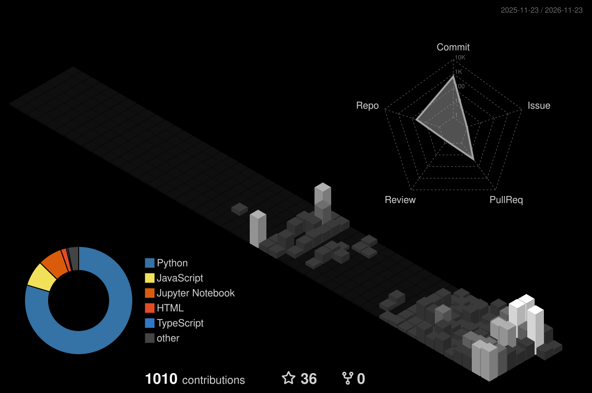

<div align="center">

<a href="https://vaibhav-barman.github.io/vaibhav-barman/">
  
</a>

<p>
  <a href="https://vaibhav-barman.github.io/vaibhav-barman/"></a>
  <a href="https://vaibhav-barman.github.io"></a>
  <a href="https://www.linkedin.com/in/vaibhavbarman/"></a>
  <a href="https://vaibhav-barman.github.io/resume.html"></a>
</p>

</div>


I build **LLM agents, RAG pipelines and MCP servers** in Python, on local models and frontier APIs alike.

One rule runs through all of it: **a model shouldn't grade its own homework.** My agents draft, then something checkable (a relevance score, a grounding check, an exit code, a rule set) decides whether the draft ships or goes back for another pass, with a hard limit on retries.

```python
class Vaibhav:
    role      = "AI Engineer"
    builds    = ["agentic systems", "self-correcting RAG", "MCP servers", "local-LLM apps"]
    graphs    = ["LangGraph", "LangChain", "FastMCP"]
    serves    = ["FastAPI", "PostgreSQL", "Docker", "AWS"]
    principle = "checks over model opinion"
    studying  = "B.Sc. Computer Science @ BITS Pilani"
    status    = "open to remote AI engineering roles"
```


<a href="https://github.com/vaibhav-barman/blog-wriring-agent"></a>

<a href="https://github.com/vaibhav-barman/self-rag"></a>

<a href="https://github.com/vaibhav-barman/corrective-rag"></a>

<sub>The panels animate the real graphs: each white packet is one run taking a different route through the nodes.</sub>




It's the same loop each time: **ISSUP / ISUSE reflection** in Self-RAG, the **retrieval evaluator** in Corrective RAG, the **critic loop** in GitCommit AI, the **execute-and-repair loop** in LocalForge-AI.


<table>
  <tr>
    <td width="50%" valign="top">
      <a href="https://github.com/vaibhav-barman/gitcommit-ai"></a>
      <h3><a href="https://github.com/vaibhav-barman/gitcommit-ai">GitCommit AI</a></h3>
      <sub><b>AGENTIC · CLI · <code>git ai-commit</code></b></sub>
      <br clear="left"/>
      <p>Learns how <i>your</i> repository writes commits, drafts a message in that voice, then a deterministic critic plus an LLM faithfulness check send it back until it passes. Never stages files, and refuses to commit if the staging area changed mid-run.</p>
      <code>LangGraph</code> <code>Python</code> <code>6 LLM providers</code> <code>Ollama</code> <code>eval harness</code>
    </td>
    <td width="50%" valign="top">
      <a href="https://github.com/vaibhav-barman/localforge-ai"></a>
      <h3><a href="https://github.com/vaibhav-barman/localforge-ai">LocalForge-AI</a></h3>
      <sub><b>MULTI-AGENT · 100% OFFLINE</b></sub>
      <br clear="left"/>
      <p>A local software team: a PM agent writes the spec, an engineer agent writes the code, a sandbox runs and lints it, and a QA agent routes real failures back for repair. Three open-weight models through Ollama, no network calls at runtime.</p>
      <code>LangGraph</code> <code>Ollama</code> <code>Python</code> <code>pytest</code>
    </td>
  </tr>
  <tr>
    <td width="50%" valign="top">
      <a href="https://github.com/vaibhav-barman/agentic-rag"></a>
      <h3><a href="https://github.com/vaibhav-barman/agentic-rag">Glossa</a></h3>
      <sub><b>AGENTIC RAG · NO FRAMEWORK</b></sub>
      <br clear="left"/>
      <p>Answers next to the passages they came from. Hybrid keyword + vector search with reranking, incremental ingestion, and an agent that can also query the library with SQL, hand a document to a sub-agent or fall back to the web.</p>
      <code>FastAPI</code> <code>Postgres + pgvector</code> <code>Gemini</code> <code>RLS</code> <code>SSE</code>
    </td>
    <td width="50%" valign="top">
      <a href="https://github.com/vaibhav-barman/recovery-agent"></a>
      <h3><a href="https://github.com/vaibhav-barman/recovery-agent">Recovery</a></h3>
      <sub><b>AI AGENT · RAZORPAY AI BUILDATHON</b></sub>
      <br clear="left"/>
      <p>A payment recovery agent. It classifies why a payment failed, picks a strategy, simulates the outcome, and feeds its own past performance into the next decision, so its strategy visibly evolves.</p>
      <code>FastAPI</code> <code>SQLite</code> <code>Groq</code> <code>Llama 3.3 70B</code>
    </td>
  </tr>
  <tr>
    <td width="50%" valign="top">
      <a href="https://github.com/vaibhav-barman/gnews-mcp-server"></a>
      <h3><a href="https://github.com/vaibhav-barman/gnews-mcp-server">GNews MCP Server</a></h3>
      <sub><b>MCP · AI TOOLING</b></sub>
      <br clear="left"/>
      <p>A Model Context Protocol server that gives any MCP client live news: <code>search_news</code> with language, country, date and sort filters, and <code>get_top_headlines</code>. Runs over stdio.</p>
      <code>MCP</code> <code>FastMCP</code> <code>Python</code> <code>uv</code>
    </td>
    <td width="50%" valign="top">
      <a href="https://github.com/vaibhav-barman/odyssey-rag"></a>
      <h3><a href="https://github.com/vaibhav-barman/odyssey-rag">Odyssey RAG</a></h3>
      <sub><b>RAG · RETRIEVAL EVALUATION</b></sub>
      <br clear="left"/>
      <p>Question answering over Homer's <i>The Odyssey</i>. 850 chunks, 768-dimension Gemini embeddings, cosine top-5 retrieval, and a labelled question set that scores retrieval with Recall@K and MRR.</p>
      <code>RAG</code> <code>Gemini</code> <code>Recall@K</code> <code>MRR</code>
    </td>
  </tr>
</table>


| Experiment | What it explores |
| :-- | :-- |
| [**ApplyIQ**](https://github.com/vaibhav-barman/apply-iq) | Resume vs. job description: ATS fit, missing skills, recruiter risks. Gemini, FastAPI, PostgreSQL, Alembic. |
| [**PromptRoute**](https://github.com/vaibhav-barman/promptroute) | "Backend-as-a-prompt": a travel planner where a local Ollama model returns structured JSON in place of a server and database. |
| [**YouTube Video Summarizer**](https://github.com/vaibhav-barman/youtube-video-summarizer) | Whisper transcription plus a local LLM summary. Nothing leaves your machine. |
| [**ollama**](https://github.com/vaibhav-barman/ollama) | Local RAG lab: PDF RAG with ChromaDB and multi-query retrieval, a voice variant, function calling. |
| [**react-agent-from-scratch**](https://github.com/vaibhav-barman/react-agent-from-scratch) | The ReAct reason-act-observe loop written by hand on the Groq API, no framework. |
| [**learn-langgraph**](https://github.com/vaibhav-barman/learn-langgraph) | Notebook trail through LangGraph: workflows, prompt chaining, chatbots, persistence, tools. |
| [**coursenotes-ai**](https://github.com/vaibhav-barman/coursenotes-ai) | Turns course transcripts into structured study notes. |
| [**gemini-website-summarizer**](https://github.com/vaibhav-barman/gemini-website-summarizer) | Extracts a page's readable content and summarizes it to Markdown with Gemini. |
| [**Spendly**](https://github.com/vaibhav-barman/spendly) | Expense tracker built end to end as an agentic coding workflow with Claude Code. |


<sub><b>AGENTS &amp; LLM ORCHESTRATION</b></sub><br/>


<sub><b>MODEL PROVIDERS</b></sub><br/>


<sub><b>RETRIEVAL</b></sub><br/>


<sub><b>BACKEND &amp; DATA</b></sub><br/>


<sub><b>CLOUD &amp; DEVOPS</b></sub><br/>


<sub>Habits I build with: async APIs, authN / authZ, pagination, rate limiting (SlowAPI), migrations, structured output, bounded retries, typed code, tests.</sub>


<div align="center">




</div>


<table>
  <tr><td><sub><b>EDUCATION</b></sub></td><td>B.Sc. Computer Science, BITS Pilani</td></tr>
  <tr><td><sub><b>EXPERIENCE</b></sub></td><td>AI/ML Intern, Elevate Labs</td></tr>
  <tr><td><sub><b>CERTIFICATIONS</b></sub></td><td>AI Engineer Bootcamp 2026 · Complete MCP Developer Guide · Mastering Ollama · Docker &amp; Kubernetes Fundamentals (Scaler Academy)</td></tr>
</table>


<div align="center">

**Hiring for an AI engineering role, or building something agentic? I'd like to hear about it.**

<p>
  <a href="https://vaibhav-barman.github.io/vaibhav-barman/"></a>
  <a href="https://vaibhav-barman.github.io/resume.html"></a>
  <a href="mailto:vaibhavbarman2609@gmail.com"></a>
  
</p>



</div>
