<div align="center">

<a href="https://vaibhav-barman.github.io">
  
</a>

<p>
  <a href="https://vaibhav-barman.github.io"></a>
  <a href="https://www.linkedin.com/in/vaibhavbarman/"></a>
  <a href="mailto:vaibhavbarman2609@gmail.com"></a>
  <a href="https://vaibhav-barman.github.io/resume.html"></a>
</p>

</div>


I'm an AI engineer who builds **LLM applications, RAG pipelines and multi-agent systems** in Python, often on local models.

The idea I keep coming back to: **a model shouldn't grade its own homework.** My agents draft, then deterministic checks (exit codes, linters, rule sets, retrieval metrics) decide whether the draft ships or loops back for repair.

```python
@dataclass(frozen=True)
class Vaibhav:
    role      = "AI Engineer"
    builds    = ("agentic systems", "RAG pipelines", "MCP servers", "local-LLM apps")
    orchestr  = ("LangGraph", "LangChain", "FastMCP")
    serves    = ("FastAPI", "PostgreSQL", "Docker", "AWS")
    principle = "deterministic checks over model opinion"
    studying  = "B.Sc. Computer Science @ BITS Pilani"
    status    = "open to remote AI engineering roles"
```




The same loop shows up across my projects: the **critic loop** in GitCommit AI, the **execute-and-repair loop** in LocalForge-AI, and the **strategy memory** in the payment recovery agent.


<table>
  <tr>
    <td width="50%" valign="top">
      <a href="https://github.com/vaibhav-barman/gitcommit-ai"></a>
      <h3><a href="https://github.com/vaibhav-barman/gitcommit-ai">GitCommit AI</a></h3>
      <sub><b>AGENTIC · CLI · <code>git ai-commit</code></b></sub>
      <br clear="left"/>
      <p>Learns how <i>your</i> repository writes commits (convention, style, history), drafts a message in that voice, then a deterministic critic plus an LLM faithfulness check send it back until it passes. Never stages files, and refuses to commit if the staging area changed while it was thinking.</p>
      <p><sub><code>diff + history → analyst → retrieval → generator ⇄ critic → you confirm → commit</code></sub></p>
      <code>LangGraph</code> <code>Python</code> <code>6 LLM providers</code> <code>Ollama</code> <code>eval harness</code> <code>mypy strict</code>
    </td>
    <td width="50%" valign="top">
      <a href="https://github.com/vaibhav-barman/localforge-ai"></a>
      <h3><a href="https://github.com/vaibhav-barman/localforge-ai">LocalForge-AI</a></h3>
      <sub><b>MULTI-AGENT · 100% OFFLINE</b></sub>
      <br clear="left"/>
      <p>A local multi-agent software team: a Product Manager agent writes the spec, a Software Engineer agent writes the code, a sandbox runs and lints it, and a QA agent routes real failures back for repair. Three open-weight models through Ollama, zero network calls at runtime.</p>
      <p><sub><code>task → product manager → engineer ⇄ run + lint → QA analyzer → package</code></sub></p>
      <code>LangGraph</code> <code>Ollama</code> <code>Python</code> <code>pytest</code> <code>local LLMs</code>
    </td>
  </tr>
  <tr>
    <td width="50%" valign="top">
      <a href="https://github.com/vaibhav-barman/agentic-rag"></a>
      <h3><a href="https://github.com/vaibhav-barman/agentic-rag">Glossa</a></h3>
      <sub><b>AGENTIC RAG · NO FRAMEWORK</b></sub>
      <br clear="left"/>
      <p>Ask questions about your own documents and read each answer next to the passages it came from. Built from raw parts: hybrid keyword + vector search with reranking, incremental ingestion, and an agent that can also query the library with SQL, hand a whole document to a sub-agent, or fall back to the web. Every tool call is shown as a step.</p>
      <p><sub><code>upload → chunk + embed → hybrid search + rerank → agent tools → cited answer</code></sub></p>
      <code>FastAPI</code> <code>Postgres + pgvector</code> <code>Gemini</code> <code>Row-Level Security</code> <code>SSE</code>
    </td>
    <td width="50%" valign="top">
      <a href="https://github.com/vaibhav-barman/recovery-agent"></a>
      <h3><a href="https://github.com/vaibhav-barman/recovery-agent">Recovery</a></h3>
      <sub><b>AI AGENT · RAZORPAY AI BUILDATHON</b></sub>
      <br clear="left"/>
      <p>A payment recovery agent. It classifies why a payment failed, picks a strategy (retry, delayed retry, UPI nudge, email nudge, escalate), simulates the outcome, and feeds its own past performance into the next decision, so its strategy visibly evolves.</p>
      <p><sub><code>failed payment → history + stats → LLM diagnosis → strategy → simulate → record ⟲ learn</code></sub></p>
      <code>FastAPI</code> <code>SQLite</code> <code>Groq</code> <code>Llama 3.3 70B</code> <code>structured JSON</code>
    </td>
  </tr>
  <tr>
    <td width="50%" valign="top">
      <a href="https://github.com/vaibhav-barman/gnews-mcp-server"></a>
      <h3><a href="https://github.com/vaibhav-barman/gnews-mcp-server">GNews MCP Server</a></h3>
      <sub><b>MCP · AI TOOLING</b></sub>
      <br clear="left"/>
      <p>A Model Context Protocol server that gives any MCP client live news: <code>search_news</code> with language, country, date and sort filters, and <code>get_top_headlines</code>. Runs over stdio, launched by the client.</p>
      <p><sub><code>MCP client ⇄ stdio ⇄ FastMCP tools → GNews API</code></sub></p>
      <code>MCP</code> <code>FastMCP</code> <code>Python</code> <code>uv</code>
    </td>
    <td width="50%" valign="top">
      <a href="https://github.com/vaibhav-barman/odyssey-rag"></a>
      <h3><a href="https://github.com/vaibhav-barman/odyssey-rag">Odyssey RAG</a></h3>
      <sub><b>RAG · RETRIEVAL EVALUATION</b></sub>
      <br clear="left"/>
      <p>Question answering over Homer's <i>The Odyssey</i>, grounded in retrieved passages. 850 chunks, 768-dimension Gemini embeddings, cosine top-5 retrieval, and a labelled question set to score retrieval with Recall@K and MRR.</p>
      <p><sub><code>source text → chunk → embed → cosine top-5 → grounded answer</code></sub></p>
      <code>RAG</code> <code>Gemini</code> <code>embeddings</code> <code>Recall@K</code> <code>MRR</code>
    </td>
  </tr>
</table>


| Experiment | What it explores |
| :-- | :-- |
| [**ApplyIQ**](https://github.com/vaibhav-barman/apply-iq) | Resume vs. job description analysis: ATS fit, missing skills, recruiter risks. Gemini, FastAPI, PostgreSQL, Alembic. |
| [**PromptRoute**](https://github.com/vaibhav-barman/promptroute) | "Backend-as-a-prompt": a travel planner where a local Ollama model returns structured JSON instead of a server and database. |
| [**YouTube Video Summarizer**](https://github.com/vaibhav-barman/youtube-video-summarizer) | Whisper transcription plus a local LLM summary. Nothing leaves your machine. |
| [**ollama**](https://github.com/vaibhav-barman/ollama) | Local RAG lab: PDF RAG with ChromaDB and multi-query retrieval, a voice-enabled variant, function calling. |
| [**react-agent-from-scratch**](https://github.com/vaibhav-barman/react-agent-from-scratch) | The ReAct reason-act-observe loop written by hand on the Groq API, no framework. |
| [**learn-langgraph**](https://github.com/vaibhav-barman/learn-langgraph) | Notebook trail through LangGraph: workflows, prompt chaining, chatbots, persistence, tools. |
| [**coursenotes-ai**](https://github.com/vaibhav-barman/coursenotes-ai) | Turns course transcripts into structured study notes. |
| [**gemini-website-summarizer**](https://github.com/vaibhav-barman/gemini-website-summarizer) | Extracts a page's readable content and summarizes it to Markdown with Gemini. |
| [**Spendly**](https://github.com/vaibhav-barman/spendly) | Expense tracker built end to end as an agentic coding workflow with Claude Code. |


**Agents & LLM orchestration**


**Model providers**


**Backend & data**


**Cloud & DevOps**


<sub>Production habits I build with: async APIs, authN / authZ, pagination, rate limiting (SlowAPI), migrations, typed code, tests.</sub>


<div align="center">


</div>


<table>
  <tr><td><b>Education</b></td><td>B.Sc. Computer Science, BITS Pilani</td></tr>
  <tr><td><b>Experience</b></td><td>AI/ML Intern, Elevate Labs</td></tr>
  <tr><td><b>Certifications</b></td><td>AI Engineer Bootcamp 2026 · Complete MCP Developer Guide · Mastering Ollama · Docker &amp; Kubernetes Fundamentals (Scaler Academy)</td></tr>
</table>


<div align="center">

**Hiring for an AI engineering role, or building something agentic? I'd like to hear about it.**

<p>
  <a href="https://vaibhav-barman.github.io"></a>
  <a href="https://vaibhav-barman.github.io/resume.html"></a>
  <a href="https://www.linkedin.com/in/vaibhavbarman/"></a>
  <a href="mailto:vaibhavbarman2609@gmail.com"></a>
  
</p>



</div>
